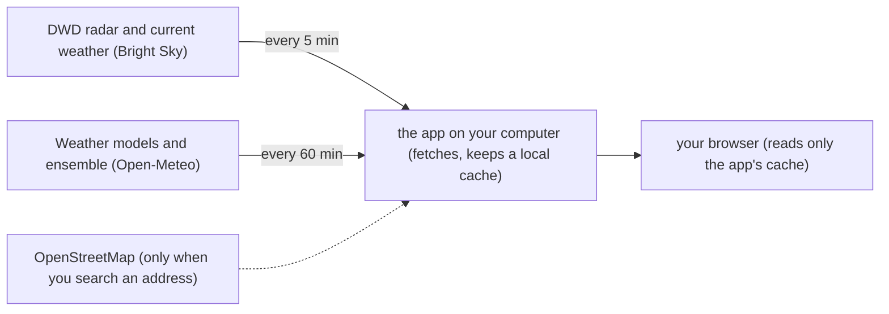

# Local Rain Forecast

A self-hosted rain forecast for one place — your home — that answers the question "Will it rain in the next hour?". It combines the DWD weather radar with six weather models and a 50-member ensemble, all from free data sources that need no account and no API key, and it runs entirely on your own computer (a Linux PC, a Raspberry Pi, or Docker Desktop on Mac/Windows).

## How it works



In words: the app on your computer fetches the radar and current weather every 5 minutes and the model forecasts plus the ensemble every 60 minutes, and keeps a local copy of everything (a cache). Your browser only ever reads that local copy — opening or refreshing the page never asks the weather services for anything new.

## What you see

Once a location is set, the page works in English or German (following your browser's language). The header shows the place in two lines, with its coordinates and time zone under it, a map-pin button that reopens the setup wizard, a view button and the light/dark button (the page follows your system setting until you use it). Times use the place's time zone in your browser's time format; wind is in km/h.

There are two views, and the big view is the default on every screen:

- **The big view** — the answer, Now and the 24-hour chart, in large type. On a desktop or tablet it fits one screen without scrolling; on a phone the cards stack in one column that scrolls.
- **The detailed view** — only the Details card (see [Reading the page](#reading-the-page)).

The view button switches between the two. Its text says where a click goes — "Details" in the big view, "Big view" in the detailed view (in German: "Details" / "Große Ansicht") — and the page remembers your choice per device. `?detailed` opens the page directly in the detailed view.

In the big view, top to bottom:

- **The answer** — one sentence: "No rain expected in the next hour", "Rain possible in the next hour" or "Rain likely in the next hour". Under it, what the radar sees right now ("Radar: raining now, until 1:05 PM"; outside Germany: "Radar: not available").
- **The "why" line** — it says what the sky shows and which source decided it: for example "Sky: rain, reported by station Munich (12.4 km away)", "Sky: partly cloudy here, seen by the radar", or, when the station reports rain but the radar at your place is dry, "Sky: cloudy — dry here according to the radar; station … reports rain". A report of yours that is still fresh decides the sky and is named with its time.
- **The chance** — the big number, labelled "chance of rain in the next 60 min".
- **The radar strip** — one column per 5 minutes for the strongest rain near you, with the hour's times under it; the caption names the radius it looks at (1 km by default). On a dry hour it says "Dry for the next 60 minutes".
- **Now** — the temperature and the condition in large type, then Feels like, Wind (km/h plus a compass point), Gusts, Humidity, Pressure, Dew point, Clouds and Rain last hour. Under it: "as of" the observation time, and the station the values come from ("Station Berlin-Tempelhof · 5.8 km"). A value that came from another station is marked "from {station}".
- **Next 24 hours** — one line per weather model, in millimetres per hour, or "No rain expected in the next 24 hours" on a dry day.

**The sky:** behind the tiles, an animated scene shows the weather at your place right now — clear (day or night), partly cloudy, cloudy, fog, windy, rain, heavy rain, sleet, snow, hail or thunderstorm. The tiles are glass, so you see it through them. The scene comes from the weather station's report and the radar at your place: rain on the radar shows rain even when the station is dry, and a station report of rain, sleet, snow or hail becomes cloudy when the radar at your place is dry, because the station can be kilometres away while the radar measures at your place ([REQ_SKY_3](docs/REQUIREMENTS.md)); a thunderstorm is always shown, since it can arrive quickly. While one of your reports is fresh (30 minutes), your report decides the sky. With your system's "reduce motion" setting, the sky is a still picture.

**When the page is wrong:** the Now tile has a "Report" button (a pencil). The tile turns over; its back is titled "What is it really like?", shows "The page shows: {scene}" and eight picture buttons — Clear, Partly cloudy, Cloudy, Fog, Rain, Thunderstorm, Snow, Hail. Tap the right one and the report saves at once; "That's right" confirms what the page shows. For rain, the page first asks for the strength — Light, Moderate or Heavy — or "Skip". You can also say the report is about 15 or 30 minutes ago, not now. While the report is fresh, the front of the tile shows "Reported by you: rain · 1:45 PM" (or "Confirmed by you: …") with an "Undo"; if saving fails, "The report could not be saved." keeps the back open.

Outside Germany the radar does not reach you. The page shows "Radar: not available" and the chance is computed from the weather models and the ensemble alone, with the radar's weight given to them ([REQ_PROB_6](docs/REQUIREMENTS.md)).

**Wall display:** open `http://localhost:8000/?kiosk` on a landscape tablet or TV. The big view fits one screen without scrolling, with large type: the answer on the left, Now and the 24-hour chart on the right (one column on a phone). The view, location and report buttons are hidden, so nobody standing at the wall can change it.

## What you need

- **Podman** (with podman-compose) or **Docker** (with Compose), on the machine that will run the app. A *container* is the isolated little environment the app runs in, and the *volume* is the app's data store on your disk.
- An **internet connection** — the weather data is downloaded from free services.
- **About 12 MB of disk** for the container image, plus a little extra for the cached data.
- **About 10 MB of RAM** while it runs.

One geographic limit: **the radar covers Germany only.** Elsewhere the app automatically drops the radar from the calculation and computes the rain chance from the weather models and the ensemble alone — the page tells you when that is the case.

## Install and first start

Upgrading from v1 (the Python app)? Follow [docs/MIGRATION.md](docs/MIGRATION.md); your data is kept.

Get the code onto your machine:

```bash
git clone <repo-url>
```

Change into the folder it created, then start the app:

```bash
cd <folder>
podman compose up -d --build
```

With Docker the same command is:

```bash
docker compose up -d --build
```

This builds the container image if needed (the first build compiles the app: a few minutes, longer on a Raspberry Pi) and starts the app in the background. Now open `http://localhost:8000` in your browser.

**The setup wizard appears**, because the app ships without a location. It is titled "Set your location" and explains: "Pick the spot this app watches for rain." You have two ways to set it:

- **Search an address or place.** Type at least 3 characters (for example `Marienplatz 1, München`) and press **Search** (or Enter). Matching results appear below the field; click the one that is yours. If only one matches, it is selected automatically.
- **Enter coordinates.** Type the latitude and longitude into the two fields; pasting `48.137, 11.575` into either field fills both.

Then **check the timezone** (it is prefilled from your browser) and press **Save location**. The location is stored in the app's data store, and the first data appears within a few seconds. From now on, the map-pin button in the header reopens the wizard.

Two notes from the wizard itself: the address search sends the text you type to OpenStreetMap's Nominatim from the app, and the radar covers Germany only — elsewhere the forecast uses the weather models only.

## Reading the page

The **detailed view** (the "Details" button) shows one card with six sections.

**Signals and weights** has two lines, for example:

> Radar 50% · Models 30% · Ensemble 20%<br>
> Radar: raining · Models: 3 of 6 · Ensemble: 35%

The first line is how much each signal counts; the second is what each one says right now: whether the radar sees rain near you, how many of the six weather models predict more than 0.1 mm of rain in the next hour, and the **ensemble** figure — the share of the 50 ensemble members that forecast rain. Outside Germany there is no radar, and its weight goes to the other two. With accuracy weighting on (a setting, off by default), a third line says "Models weighted by their hit rate"; it applies once every model has enough compared hours.

**Refresh** has three live countdowns: to the next radar fetch, the next model fetch and the next page reload (the page reloads with fresh data shortly after each backend fetch).

**Data sources** has one row per source — Radar, Now, Models and Ensemble — with the service it comes from and the age of the cached copy. **stale** means the copy is older than the freshness limit (10 minutes for the radar, 2 hours for the models) — the app keeps showing the old data rather than nothing, and keeps retrying. **n/a** means the app has not yet managed a successful fetch from that source. The last error of a source is shown under its row.

**Model accuracy** compares each model's past forecasts with the observations, hour by hour, over the last 30 days: the Hours compared, the Hits, Misses and False alarms, the Hit rate and the Avg. error. A model's numbers count as reliable once it has 48 compared hours; until then its row is greyed. The plain-words text under the table explains what each column means.

**Against your reports** repeats the same comparison, but scored against your reports instead of the station: the same forecast hours, your newest report per hour, and the wet kinds (rain, thunderstorm, snow, hail) counting as rain. It is its own block — the station's table, the weights and the forecast do not use your reports ([REQ_REPORT_8](docs/REQUIREMENTS.md)).

**Stations** lists the weather stations — name, distance, how many hours they have measured — and draws a schematic map: your place in the centre, the stations by bearing and distance, the radar radius as a circle, a north arrow and a scale bar.

If you want to know exactly how the percentage is calculated, see [docs/ARCHITECTURE.md](docs/ARCHITECTURE.md).

## Everyday tasks

### Open it from your phone or another computer

From another device on your network, use the machine's IP address, `http://<ip>:8000` — on Linux you find it with:

```bash
hostname -I
```

— or the machine's local name, `http://<computer-name>.local:8000`. Any other name (for example a router name like `pi.fritz.box`) has to be added to `ALLOWED_HOSTS` in `docker-compose.yml` — there is a commented example right in the file — otherwise the browser shows "Invalid host header".

### Change the location

The map-pin button in the header reopens the setup wizard. Changing the location deletes the cached data and the model-accuracy history; the app asks before it does that.

### Use another port

```bash
PORT=9000 podman compose up -d
```

### Stop and start the app

```bash
podman compose down
```

stops the app. **Your data is kept** — it lives in the volume, not in the container. Start it again with:

```bash
podman compose up -d
```

(Docker: `docker compose down` / `docker compose up -d`.)

### Start automatically after a reboot

With Docker this works on its own. With Podman, run these two commands once:

```bash
sudo loginctl enable-linger $USER
systemctl --user enable podman-restart.service
```

The first lets your user's services run at boot without anyone logging in; the second starts the app's container at boot. After the next reboot, `podman ps` should list `weather-app`. A container you removed with `podman compose down` stays off until you start it again.

### Update to a new version

```bash
git pull
```

then rebuild and restart:

```bash
podman compose up -d --build --force-recreate
```

With Docker it is `docker compose up -d --build`. The `--force-recreate` is the important part for Podman: podman-compose keeps the old container when only the image changed, so without the flag the update would silently not take effect. Docker Compose replaces the container on its own.

### See the log

```bash
podman logs -f weather-app
```

shows what the app is doing, one line at a time; stop it with Ctrl+C. With Docker it is `docker logs -f weather-app`.

### Back up and restore your data

Everything the app stores (location, cache, accuracy history) lives in a volume named after the folder — for a folder called `wetter` it is `wetter_weather-data`. Check your name with `podman volume ls`. To back it up:

```bash
podman volume export wetter_weather-data > weather-backup.tar
```

To restore it later (for example on a new machine):

```bash
podman compose down
podman volume import wetter_weather-data weather-backup.tar
podman compose up -d
```

Docker has no `volume export`; instead use a temporary container:

```bash
docker run --rm -v wetter_weather-data:/data:ro -v "$PWD":/backup alpine tar cf /backup/weather-backup.tar -C /data .
```

### Uninstall

```bash
podman compose down -v
```

removes the app **and all of its data** (the volume). Do this only after you made a backup you want to keep.

## Settings you might change

| Setting | Where | Notes |
| --- | --- | --- |
| Radar radius | `radar.radius_km` in `weather.yaml` (currently `1.0`) | How close the radar has to see rain for it to count as "local rain". After changing it, rebuild so the file is baked into the image again: `podman compose up -d --build --force-recreate` (Docker: `docker compose up -d --build`). |
| Port | `PORT=9000 podman compose up -d` | Any free port on your machine. |
| Extra host names | `ALLOWED_HOSTS` in `docker-compose.yml` | Needed when you open the app under a name that is not the IP or the `.local` name (see above). |
| Accuracy weighting | `USE_ACCURACY_WEIGHTS: "true"` under `environment:` in `docker-compose.yml` | Off by default. Worth turning on after about 2 days, once the Model accuracy card has enough history. |

For everything else (weights, models, refresh cadence, accuracy window) see [docs/DEVELOPMENT.md](docs/DEVELOPMENT.md).

## Privacy and security, in plain words

- The app runs only on your computer. There is no account, no login, no tracking, and nothing about you is sent to the app's author.
- To get your forecast, your coordinates are sent to the weather services (Bright Sky/DWD and Open-Meteo). If you use the address search, the text you type is sent to OpenStreetMap's Nominatim **from the app's server**, not from your browser. Coordinates you type in yourself are sent to the weather services and nowhere else.
- The app is meant for your home network. **Don't open or forward its port on your router.** Anyone on your home network can open the page and change the location.
- For the technical details, see [docs/SECURITY.md](docs/SECURITY.md).

## Troubleshooting

- **The browser shows "Invalid host header".** The name you opened the app under is not one the app answers to. Use the IP or the `.local` name, or add the name to `ALLOWED_HOSTS` in `docker-compose.yml` and start again.
- **The page says "Could not reach the API. Refreshing…".** The app is not running. Check with `podman ps` (Docker: `docker ps`) whether the `weather-app` container is up, and look at the log (`podman logs -f weather-app`).
- **Everything shows "stale" or "no data".** The app can't reach the weather services — check your internet connection — or it has only just started. Look at the Data sources card (it shows the last error per source) and the log.
- **The radar card says "Radar not available for this location (models-only display)."** Your location is outside the radar's coverage area (Germany). The forecast still works — it uses the weather models only.
- **Starting fails with "Address already in use"** (or a similar port-busy message). Something else already uses port 8000. Start with another port: `PORT=9000 podman compose up -d`.
- **After updating an old install, the log shows "unable to open database file".** Installs from before the app switched to a non-root user need a one-time fix for the data volume — the command is in [docs/SECURITY.md](docs/SECURITY.md).

## Data sources and credits

- **DWD radar and current weather** via [Bright Sky](https://brightsky.dev).
- **Weather models and ensemble** from [Open-Meteo](https://open-meteo.com), free for non-commercial use.
- **Address search** by OpenStreetMap Nominatim — © [OpenStreetMap contributors](https://www.openstreetmap.org/copyright).

## For developers

- [docs/ARCHITECTURE.md](docs/ARCHITECTURE.md) — how the rain probability is calculated, data conventions, project layout.
- [docs/API.md](docs/API.md) — the endpoints and the response contract.
- [docs/SECURITY.md](docs/SECURITY.md) — the security setup and the one-time volume migration for old installs.
- [docs/DEVELOPMENT.md](docs/DEVELOPMENT.md) — running without Docker, tests, all settings.
- [docs/SCOPE.md](docs/SCOPE.md) — purpose, features and requirements.

The project is developed with an AI coding agent; its rules are in `.continue/rules/weather-projectrules.md` (see [docs/DEVELOPMENT.md](docs/DEVELOPMENT.md)).

## License

The code is released under the [MIT License](LICENSE). The weather and map data belong to their providers and follow their own terms (see [Data sources and credits](#data-sources-and-credits)).
