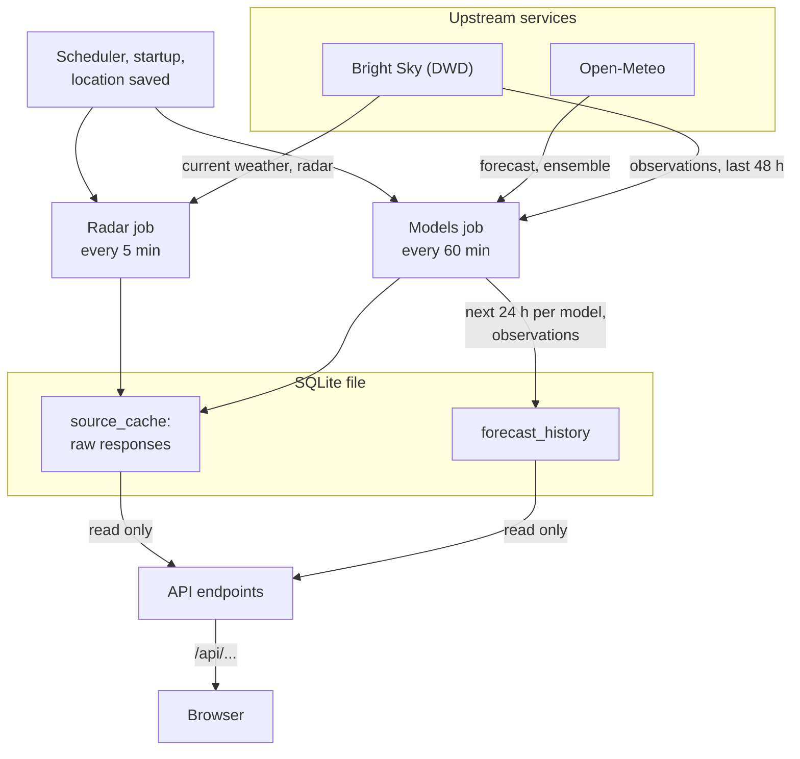
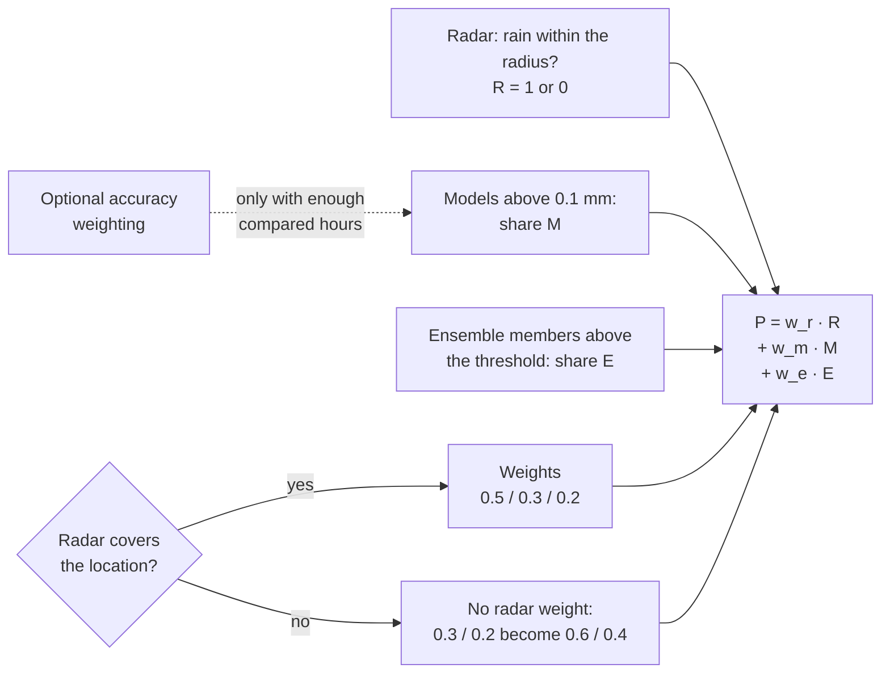
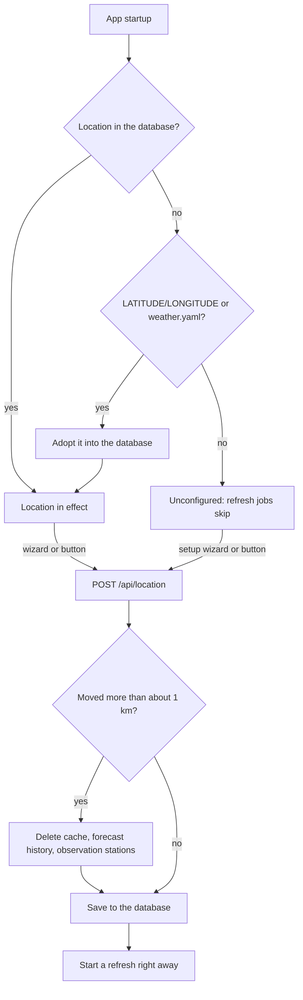

# Architecture

How the app works, for developers: how the rain probability is calculated, the data conventions of the upstream sources, the sky and the user reports, the project layout, and how the code is checked.

## Data flow

The scheduler keeps the local cache and history up to date, and the browser only ever reads from them — never from the upstream services.



## How the rain probability is calculated

Three independent signals for the **next 60 minutes**, combined linearly:

1. **Radar nowcast** (highest weight, default 0.5) — the DWD radar grid is scanned for cells within `radar.radius_km` of your location. If any cell in the relevant 5-minute steps exceeds the rain threshold, radar "votes rain" (binary 0/1).
2. **Model agreement** (default 0.3) — each configured Open-Meteo model sums its 15-minute precipitation for the next hour; the signal is the *share* of models forecasting more than `model_rain_threshold_mm` (0–100 %).
3. **Ensemble probability** (default 0.2) — share of ECMWF ensemble members (50) whose precipitation for the next hour exceeds the threshold. The ensemble has hourly data only, so it uses the hour that overlaps the next 60 minutes the most (the first hourly step stamped `>= now + 30 min`).

The three signals are combined in one weighted sum, with a fallback when radar has no coverage and an optional accuracy weighting for the model signal:



```
P = w_r * R + w_m * M + w_e * E          (weights renormalized to sum 1)
```

- `R` = 1 if radar sees rain nearby, else 0
- `M` = (models with rain) / (models available)
- `E` = (members with rain) / (members available)

**Fallback (no radar coverage, e.g. outside Germany):** `w_r` is dropped and the remaining weights are re-normalized automatically (0.3/0.2 becomes 0.6/0.4). The UI always shows the derivation, e.g. "Radar: yes, 3 of 5 models, 42 % ensemble".

**Scoring the models (`GET /api/model-accuracy`):** MAE alone is misleading — during a dry spell a model that always says 0 mm has a near-zero MAE without ever being right about rain. So each model is scored on the *same yes/no event* the vote uses (``> model_rain_threshold_mm``), over the last `accuracy.window_days` days: `hits` (rain forecast, rain observed), `misses`, `false_alarms`, `correct_negatives`, and `event_accuracy = (hits + correct_negatives) / n_samples`. `mae_mm` is reported for context. A model is flagged `enough_data` once it has at least `accuracy.min_samples` compared hours; the response's `models` dict is empty while nothing has been compared yet (fresh install — observations accumulate hourly via the backfill).

**Optional accuracy weighting (`USE_ACCURACY_WEIGHTS`):** with this switch on, the model signal `M` is no longer the equal-weight share of models with rain. Each voting model's vote (100 if it forecasts `> model_rain_threshold_mm`, else 0) is weighted by its `event_accuracy` from the scoring above, and `M = 100 * sum(w_i * rain_i) / sum(w_i)` with `w_i = max(event_accuracy, 0.1)` — the 0.1 floor keeps a poor model from being silenced entirely, and a model with no accuracy data yet gets the floor. **Gate:** if *any* voting model has fewer than `accuracy.min_samples` compared hours (or no accuracy row at all), the scores are not trustworthy yet and the signal falls back to the plain equal-weight share. The radar and ensemble weights are never changed. The explanation string gets ", accuracy-weighted" appended only when the weighting was actually applied (i.e. the gate passed), and models without next-hour data still do not vote — they also don't trip the gate.

A failing source never blocks the app: the last good cache is served with its age shown in the UI, and sources older than the configured threshold are flagged stale.

## Data conventions

The upstreams timestamp precipitation differently; the backend normalizes everything to UTC and follows these rules (verified against the live APIs):

- **Open-Meteo hourly precipitation** at timestamp `t` is the rain of the *preceding hour* `[t-1h, t)` — a sum, not an instantaneous value.
- **Open-Meteo minutely_15 precipitation** at timestamp `t` is the rain of the preceding 15 minutes `[t-15min, t)`. The hourly value at 11:00 equals the sum of the 15-min values at 10:15, 10:30, 10:45 and 11:00.
- **Open-Meteo apparent_temperature** (hourly) is an *instantaneous* value at `t`, not a sum.
- **Bright Sky `/weather`** hourly records: `precipitation` at timestamp `T` is the rain of the preceding hour `[T-1h, T)`; `observation_type` `"current"`/`"historical"` marks real observations, `"forecast"` marks MOSMIX forecasts.
- **Next-hour window rule:** a step with end-stamp `t` belongs to `[now, now+1h)` when `now < t <= now + 1h`. A step stamped exactly `now` is already in the past.
- **Single-hour pick (ensemble vote):** when *one* whole hour must represent the next 60 minutes, pick the hourly step with the largest overlap with `[now, now+1h)` — i.e. the first stamp `t` with `t >= now + 30 min`. Example: at `now = 10:50` the step stamped 11:00 (covering 10:00–11:00) would be 50 minutes in the past, so the step stamped 12:00 (covering 11:00–12:00, 50 min ahead) is used instead.
- **Observation backfill:** every hourly refresh fetches the last 48 h of Bright Sky `/weather` records and writes each real observation (station source, `observation_type != "forecast"`) into `forecast_history.observed_mm` for its hour start (`timestamp - 1h`). This catches up hours missed while the app was down.

### Forecast history (accuracy extension)

`forecast_history` stores one row per `(model, valid_from)` (unique index). Every hourly refresh *upserts* the rows for the next 24 hours: the latest forecast issued before the hour started (shortest lead time) wins, and a row that already has an observation is never overwritten. A one-time migration (tracked in `app_meta`, key `forecast_history_version`) empties the table and adds the unique index on the first startup after this change (schema v2), then a later startup (schema v3) drops the unused `model_accuracy` table — accuracy is now computed on demand from `forecast_history` — and is a no-op afterwards. Observations are filled by the hourly backfill described above; `observed_mm` stays `NULL` until the hour's observation exists.

## The sky and the scene

The background behind the tiles shows the current weather as an animated scene (REQ_SKY_1). `index.html` holds the fixed `.sky` layer (the first child of `<body>`, behind everything, `pointer-events: none`); the header, the footer and the setup card keep an opaque card background, the data tiles are glass so the sky shows through them (REQ_SKY_4). `app.js` names the scene on `<html data-scene>` on every refresh; `sky.css` paints one gradient per scene per theme and animates the particles; `sky.js` fills the particle containers once at startup (stars, wind streaks, rain drops, snow flakes, hail stones, the clouds and the sun, moon and lightning bolt in the markup) with random positions and timings. All motion sits under `prefers-reduced-motion: no-preference`; with reduced motion the sky is a still picture (REQ_SKY_5).

The scene is decided by `sceneReason()` in `format.js` (pure; the UI tests run it in Node). It looks at two inputs from the API: the station's icon (`/api/now` conditions icon — one of Bright Sky's twelve) and the radar at the place right now (the first five-minute step of `/api/radar/next-hour`). The rules:

- Rain on the radar overrides a dry icon: a wet first step shows "heavy-rain" at 0.2 mm or more per step, "rain" below (REQ_SKY_2). It does not override sleet, snow, hail or a thunderstorm: the radar can't tell snow from rain, so those icons stay while it rains.
- A dry radar beats a wet station: the station's rain, sleet, snow or hail icon becomes "cloudy", because the station can be kilometres away and the radar measures at the place itself (rule B, REQ_SKY_3). A thunderstorm stays a thunderstorm even with a dry radar — it can arrive fast (REQ_SKY_3).
- The station's "rain" icon follows the radar at the place: dry radar gives "cloudy", a wet radar gives "rain" or "heavy-rain".
- Without radar data the station's icon is shown as it is; with nothing to show the scene is "none" and the sky shows the plain page background.

`app.js` then picks the freshest input: a fresh user report (REQ_REPORT_6) decides the sky via `reportkind.js` (REQ_SKY_7), otherwise the station and the radar decide. The "why" line under the answer (REQ_GLANCE_4, REQ_SKY_6) is rendered by `glance.js` and names what the sky shows and who decided it: the station with its distance, the nearest station, the radar, or the user's report with its time. It is hidden when the source is "none".

## User reports

The page's "Not right?" feature lets the user record the real weather when reality and the forecast differ (REQ_REPORT_1). The host tile is found by its `data-report-host` attribute in the page, not by an id, so another tile can host it later (REQ_REPORT_7); today the host is the Now tile.

The UI is `report.js` with `report.css`. The front corner carries a pencil button with the word "Report" (REQ_REPORT_2); it turns the tile over to the back (`role="dialog"`, the front goes inert), which shows "The page shows: {scene}" with a "That's right" confirm button (REQ_REPORT_4) and eight picture buttons for the kinds in `reportkind.js` (REQ_REPORT_1). Tapping a kind saves at once — rain first asks for its intensity (light, moderate, heavy, or skip) (REQ_REPORT_3) — together with the "when" chip the user pressed: now, 15 or 30 minutes ago. Saving POSTs `{kind, minutes_ago, confirms, intensity?}` to `/api/reports`; the server's clock sets `observed_at`, the client sends no times. A failed save says so and keeps the back open (REQ_REPORT_5). While a report is fresh the front shows the report and its time ("Reported by you", or "Confirmed by you" for a "That's right") with an undo; the undo DELETEs the report and re-reads the current state (an older fresh report may show again). The locked wall display (`?kiosk`) has no report button (REQ_REPORT_10).

The backend is `reports.rs` (closed-set validation: eight kinds, three intensities, `minutes_ago` of 0/15/30, `confirms`; unknown fields and client times are refused with a 422), `routes/reports.rs` (freshness and storage) and `store/reports.rs` (the `user_reports` table: `id, kind, intensity, confirms, observed_at`). A report is fresh for 30 minutes, both ends inclusive (REQ_REPORT_6); the newest fresh report decides the sky (REQ_SKY_7). Every save prunes the table: older than the accuracy window (`accuracy.window_days`) first, then all but the newest 500 (REQ_REPORT_9).

`reports/score.rs` adds the `user_reports` block to `GET /api/model-accuracy`, and `reportdetails.js` renders it in the Details card as "Against your reports", right after the station's accuracy table, sharing its rows with `accuracyrows.js` (REQ_REPORT_8, REQ_DETAILS_4). The scoring follows REQ_REPORT_8: per UTC hour the newest report decides, the wet kinds (rain, thunderstorm, snow, hail) count as rain, and the models are scored on the same forecast hours as the station with the same threshold. The station's table, the weights and the vote stay station-only.

## Project layout

The app is the Rust crate in `rust/`; `app/static/` is the web page it serves. The Python app (v1) is gone, but the contract suite's goldens were recorded from it and are frozen since v2.0 (its code is kept at the git tag `python-last`).

```
weather.yaml              # runtime configuration (baked into the image)
docker-compose.yml        # deployment: the Rust app (v2)
rust/
  Dockerfile              # static binary on a distroless image
  docker-compose.yml      # variant with an explicitly named volume
  contract/               # API contract suite: frozen goldens, run against the Rust app (rust/contract/README.md)
  uitest/                 # page checks in headless Chromium (rust/uitest/README.md)
  src/main.rs             # the binary: server, `wetter snapshot PATH`
  src/lib.rs              # crate root: the private modules and the re-exports main.rs and rust/tests use
  src/config.rs           # weather.yaml + environment overrides
  src/models.rs           # the normalized types shared by parsers, logic and serializers
  src/store.rs            # SQLite: source cache, forecast history, user reports, app_meta
  src/clients.rs          # HTTP clients for Bright Sky and Open-Meteo
  src/brightsky.rs        # Bright Sky parsers (current weather, observations)
  src/radar.rs            # radar frame decoding
  src/openmeteo.rs        # model forecast + ensemble parsers
  src/upstream.rs         # shared upstream plumbing: the HTTP client, SourceError (bad data never panics)
  src/aggregator.rs       # refreshes, observation backfill, read model
  src/probability.rs      # rain probability for the next 60 minutes
  src/accuracy.rs         # per-model accuracy scoring
  src/reports.rs          # user reports: the closed sets and their validation
  src/series.rs           # 24 h series, radar bar
  src/stations.rs         # the weather stations behind the data
  src/serializers.rs      # JSON shapes of the API
  src/routes.rs           # HTTP routes
  src/security.rs         # host check, security headers
  src/scheduler.rs        # refresh jobs
  src/location.rs         # the home location (runtime state)
  src/geocode.rs          # address search (Nominatim)
  src/snapshot.rs         # consistent copy of the database
  src/static_files.rs     # serves app/static
  src/pyfmt.rs            # number formatting (as v1 did it: same JSON)
  src/times.rs            # time formatting (as v1 did it: same JSON)
  src/testutil.rs         # test-only payload builders
app/
  static/                 # the web page, served by the Rust app (no build step):
    index.html            #   the markup: the sky layer, the tiles, the report host
    view.js               #   the two views: big (default) and detailed (?kiosk locks big)
    app.js                #   entry module: language, theme, config, refresh, the sky scene
    glance.js             #   the rain answer, the "why" line, the radar strip
    now.js                #   the Now tile: current conditions and the station
    chart.js              #   the 24 h multi-model chart (inline SVG)
    details.js            #   the Details card and the page reload
    stationmap.js         #   the station rows and the schematic map
    accuracyrows.js       #   the shared rows of the two accuracy tables
    fit.js                #   the big view's headline on a narrow screen (max two lines)
    sky.js                #   the sky's particle generation
    report.js             #   the report flip tile: the picker, saving, the undo
    reportkind.js         #   the eight kinds and the kind-to-scene mapping (pure)
    reportdetails.js      #   the Details' "Against your reports" section
    setup.js              #   the location wizard
    api.js                #   the page's fetch helpers
    format.js             #   pure formatting: numbers, times, the scene
    i18n.js               #   the page's texts, English and German
    i18n-report.js        #   the report's texts, English and German
    style.css             #   tokens, themes, cards, tiles
    layout.css            #   the tile grid, the glass tiles
    kiosk.css             #   the big view (the wall display)
    chart.css             #   the chart card
    details.css           #   the Details card
    sky.css               #   the sky: the per-scene skies and the particle motion
    report.css            #   the report flip tile
```

## Location lifecycle

The location is runtime state in the database: it is resolved once at startup and changed only through the API, which clears old data when the place actually moved.



## Checks

The code is checked in four layers, cheapest first.

**Unit tests.** `cargo test` in `rust/` runs the crate's tests: the logic lives in small pure functions (the probability signals, the scene, the parsers, the validation), so each is tested directly against fixture payloads from `testutil.rs`, without a server or a database.

**The contract suite.** `rust/contract/` (its [README](../rust/contract/README.md)) proves the backend answers exactly as frozen goldens record. Scenarios with fixed "now", environment and upstream data drive the request cases through a fake upstream (`fakeup.py`) and a frozen clock; the responses are normalized and diffed against `golden/`. The goldens were recorded from the Python app and are frozen: a change to them is reviewed line by line before it is kept.

**The UI suite.** `rust/uitest/` (its [README](../rust/uitest/README.md)) checks the page in headless Chromium against the Rust app, on the contract suite's recorded Berlin data. It asserts what the page shows through `data-test` hooks, measures contrast on pixels (translucent tiles over the moving sky included), runs the sky scenario (scene, motion, stillness under reduced motion), and runs the pure page modules (`format.js`, `i18n.js`) as Node unit tests. `faults.py` plants known defects into a copy of `app/static` and fails when the harness misses one of them — the proof that the checks still see what they should.

**The doc check.** `rust/contract/doc_check.py` keeps the docs honest: every relative link in `README.md` and `docs/*.md` resolves, and this file names every file of the page and every backend module.
